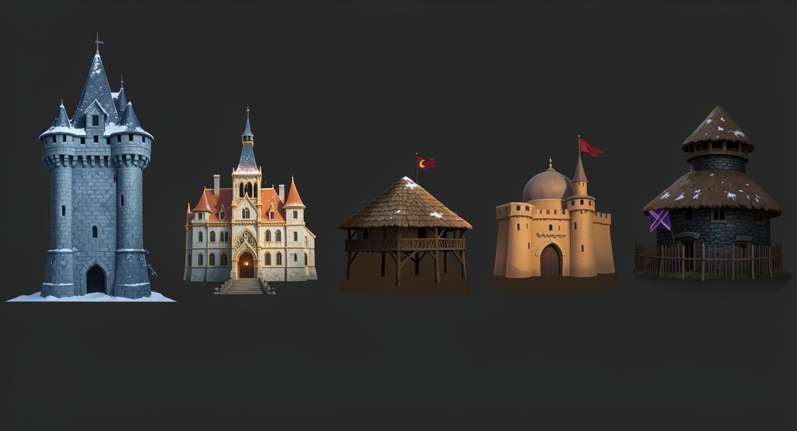
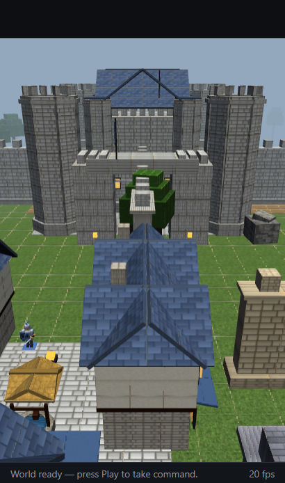
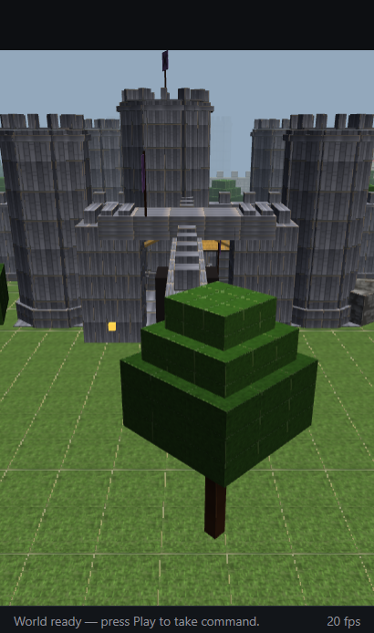
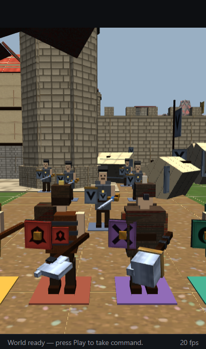
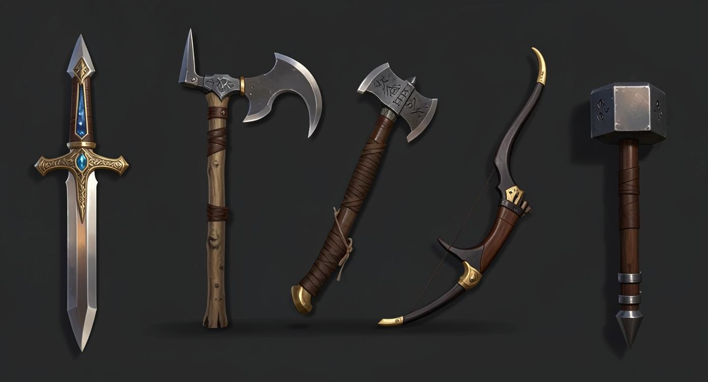
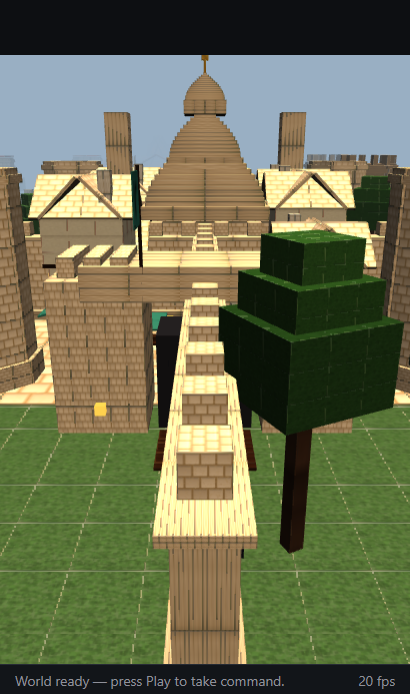

# Forge Engine — Art & Design Bible

This is the design system behind the basin: five powers, one free company, every
wall and every soldier built from the same box primitive but never from the same
silhouette.

Two rules shape everything here:

1. **Nothing is generic.** A castle is not "a box with crenellations"; each power
   builds a different fortress, hangs a different coat of arms and arms its
   soldiers differently.
2. **Nothing is binary.** All of it is authored in TypeScript and painted at boot,
   so the repository stays small and the art can be reviewed like code.

---

## 1. Design pillars

| Pillar | What it means in practice |
| --- | --- |
| **Readable silhouettes** | Every tower, helmet and weapon is identifiable from 40+ units away: drum towers vs. square keeps, kettle hats vs. turbans, halberd vs. warhammer. |
| **Material honesty** | Stone is stone, not a grey tint: five masonry traditions, three roof systems, four armour materials, four metals. |
| **House identity** | Colour is never decoration. Each power owns a stone, a roof, a metal, a coat of arms and a weapon, and all of them appear together. |
| **Layered detail** | Battered tower bases, corbelled tops, string courses, jettied upper floors, shutters, chimneys, braziers, pennants. Detail reads at every distance. |
| **Cheap to ship** | One atlas, one draw call, zero binary assets. The whole art system costs kilobytes, not gigabytes. |

---

## 2. The five powers and the free company

| House | Motto | Stone | Roof | Metal | Arms | Armour | Silhouette cue |
| --- | --- | --- | --- | --- | --- | --- | --- |
| **North Kingdom** | *Stone endures, and so do we.* | Cold dressed ashlar | Blue slate | Steel | Longsword | Plate | Great helm with a plume, kite shield, steep slate pyramid roofs |
| **River Kingdom** | *Gold in the granary, gold in the hall.* | Cream ashlar | Terracotta pantiles | Bronze | Halberd | Mail | Kettle hat, heater shield, gilded bands and a bell tower |
| **Eastern Tribes** | *The wolf takes what the wind reveals.* | Rammed earth | Oak shingle | Iron | Bearded axe | Hardened leather | Fur cap, round shield, timber-framed hall under a broad cone roof |
| **Southern Sultanate** | *Under one sun, one law.* | Warm sandstone | Sandstone dome | Bronze | Scimitar | Lamellar | Turban helm, round shield, onion dome and minaret |
| **Western Clans** | *No king above the glen.* | Dark basalt | Thatch | Iron | Warhammer | Fur | Deep fur hood, round shield, round peel tower and a thatched longhouse |
| **Free Company** | *Paid in coin, kept by steel.* | Rubble | Canvas | Steel | Longsword | Coat | Hooded captain, chevron shield, gilded crossguard, pavilion camp |

Definitions live in [`src/game/houses.ts`](../src/game/houses.ts); the builders
read only from that table, so a sixth power is a data change, not an art project.

---

## 3. Heraldry

Eight devices are painted into the atlas as light cloth fields with a dark
device, then multiplied by the instance colour at draw time. One tile therefore
serves every house: a blue tower, a gold sun, a crimson wolf, a green crescent, a
purple saltire and a steel chevron all come from the same eight pixels-of-design.

| Tile | Device | Used by |
| --- | --- | --- |
| `TOWER` | Crenellated tower | North Kingdom |
| `SUN` | Rayed sun | River Kingdom |
| `WOLF` | Wolf head | Eastern Tribes |
| `CRESCENT` | Crescent | Southern Sultanate |
| `SALTIRE` | Diagonal cross | Western Clans |
| `CHEVRON` | Chevron | Free Company |
| `CROSS`, `PALES` | Cross, vertical pales | Available for new houses |

Heraldry appears on tabards, shields, hanging banners, gate standards, gatehouse
pennants, tower pennants, cottage doors, townhouse awnings and the captain's
chest — six or more readable instances of the same arms per settlement.

---

## 4. Castles

Every castle shares a real defensive anatomy rather than a facade:

- **Curtain wall** — footing, wall body, wall-walk and individually placed
  merlons, with loopholes at fighting height on all four sides.
- **Gatehouse** — twin flanking towers, a lintel block, a recessed passage, a
  full iron portcullis (bars and rails), a plank drawbridge, braziers and the
  house standard above the arch.
- **Corner towers** — eight-sided drums with a battered plinth, corbel course,
  arrow slits, and either crenellations or a roof, plus a tower pennant.
- **Inner bailey** — paved courtyard, well with winch and bucket, market stall,
  braziers, stables, banner pole and a named champion with a garrison.
- **The keep**, which is where each power diverges.

### Keep signatures

| House | Keep |
| --- | --- |
| North | Rectangular ashlar keep, string courses, corner buttresses, battlemented parapet, four corner turrets with slate cones, steep central hip roof, two lit window rows, arched door with steps. |
| River | Great hall with a gilded double band, an arcaded loggia of piers and arches, dormers in a terracotta hip roof, tall lit windows, and an attached 18-unit bell tower with belfry openings, a bronze bell and a spire with a vane. |
| East | Timber-framed great hall on a platform: rammed-earth walls, oak posts and plates, a broad cone roof with a smoke hole and pole, glowing hearth windows. |
| South | Sandstone citadel with rounded merlons, a gold mosaic frieze, a horseshoe gate with a gilded arch ring, a 14-ring onion dome with crescent finial, and a 19-unit minaret with a railed balcony. |
| Clans | A 17-unit round peel tower with a battered footing ring, crenellated top and standard, attached to a thatched longhouse with a chimney, plus a clan banner. |

Cities add a full ring wall with four towers, a gatehouse, a civic building
(river/north), a grand mosque with twin minarets (south), a great tent (east) or a
clan hall (west), eight jettied townhouses, a statue, market stalls, a well and
braziers. Towns and villages scale the same vocabulary down to cottages with
thatch or shingle, woodpiles, haystacks and a fence ring.

---

## 5. Characters

A soldier is roughly **twenty instances**: shadow ring, two legs, two boots, a
pelvis, an armour-specific torso with pauldrons, a heraldic tabard or surcoat,
two arms, a neck, a head with eyes, a house helmet, a cloak, a shield and a
weapon — all still inside the single instanced draw call.

- **Idle and walk** are inferred from frame-to-frame movement: legs swing and the
  body bobs only when a unit is actually going somewhere.
- **Attacks** are driven by the combat cooldown, so the weapon rises and falls in
  time with the damage tick, with a steel glint during the swing.
- **Houses read at a glance**: plate + great helm + kite shield (north), mail +
  kettle hat + heater (river), leather + fur cap + round shield (east), gold
  lamellar + turban (south), fur + hood + iron nasal (clans) and a hooded captain
  with a gilded crossguard (company).
- **Civilians** carry no weapons: a hooded tunic, an apron, a basket, and a
  different walk. 38 of the 92 characters are townsfolk.
- **Health bars** appear only when a unit is wounded, and a gold ring marks the
  editor selection.

Current population: **92 characters** — 7 free company (including the player),
16 north, 28 river, 16 eastern, 16 southern, 9 clans, 38 civilians.

---

## 6. Weapons

Each house's weapon is a distinct silhouette *and* a distinct combat profile
([`WEAPON_PROFILE`](../src/game/houses.ts)):

| Weapon | Build | Damage | Speed | Cooldown | Reach |
| --- | --- | --- | --- | --- | --- |
| Longsword | pommel, leather grip, crossguard, gem (captain), fullered blade, tapered tip | 1.00 | 1.00 | 2.4 s | 2.8 |
| Halberd | ash shaft, bronze collar, crescent axe blade, rear hook, tall spike | 1.35 | 0.92 | 3.0 s | 3.6 |
| Bearded axe | oak haft, iron collar, wide head with beard, top spike | 1.20 | 1.02 | 2.6 s | 2.6 |
| Scimitar | bronze guard, three-segment curved blade with increasing tilt | 0.85 | 1.12 | 2.0 s | 2.5 |
| Warhammer | oak haft with iron bands, square head, peen spike, bronze collar | 1.50 | 0.85 | 3.2 s | 2.7 |
| Recurve bow | three horn segments, bronze riser, string, quiver across the back | 0.75 | 1.05 | 2.2 s | 9.0 |

The player's longsword is unique: a bronze crossguard with a blue gem and a gold
clasp on the chest — the "gilded" captain's blade from the character plate.

---

## 7. Materials atlas

One **1024 × 1024** canvas, **35 tiles**, painted at boot in
[`src/engine/textures.ts`](../src/engine/textures.ts).

| Family | Tiles |
| --- | --- |
| Ground | meadow grass, dry steppe grass, packed earth, desert sand |
| Masonry | dressed ashlar, rubble, basalt, sandstone, mossy stone, marble |
| Roofing | oak shingle, thatch, blue slate, terracotta pantile |
| Structures | timber planks, dark aged oak, lime plaster, rammed earth |
| Metals | steel, blackened iron, chased gold, bronze, chainmail |
| Soft | leather, fur, woven cloth, heraldic cloth |
| Water | deep water with foam sparkles |
| Heraldry | chevron, cross, saltire, wolf, crescent, tower, sun, pales |

Two engine details make the atlas hold up at a distance:

- **Guard bands.** Each tile is drawn inset by 8 px and its own edge pixels are
  smeared into the margin, and the shader samples only the inner 112 px. Mip
  filtering can therefore never bleed a neighbouring tile in, which is what
  removes the bright tiling grid you get from naive atlas mipmapping.
- **Square texels on every face.** Instances carry independent horizontal and
  vertical tiling, so a 150 × 7 road and a 30 × 7 curtain wall both keep square
  texels instead of stretching.

---

## 8. Measured cost

| Metric | Value |
| --- | --- |
| Entities | 4,544 (235 with collision bodies) |
| Instances drawn | ~6,500 |
| Draw calls | **1** |
| Instance buffer | 0.59 MiB |
| Atlas | 1024² RGBA + mips, ~5.3 MiB VRAM |
| JS bundle | 85.7 kB (29.4 kB gzip) |
| Binary art committed | 0 MB |

The settlement geometry is generated on boot, so this entire art system adds
roughly 46 kB of source rather than a megabyte of textures.

---

## 9. Concept plates

The three plates at the top of this document are original concept art for this
project and define the target look: five castle silhouettes, a character lineup
by house, and the six signature weapons. The in-engine captures (Northwatch,
Clanhold, Sahr, the house lineup) show the same direction realised with the
engine's own procedural materials.

---

## 10. What is not here yet

Honest limits of this pass:

- No skeletal animation: figures are rigid box rigs with procedural leg, arm and
  weapon motion.
- No shadows or ambient occlusion, so figures are grounded by a shadow ring
  rather than a shadow map.
- Textures are hand-painted procedural noise, not scanned PBR materials; there
  are no normal or roughness maps.
- Roofs, crenellations and domes are faceted by construction — three to fourteen
  planes, not smooth meshes.
- No cloth simulation, no weather, no siege engines, no interior rooms.
